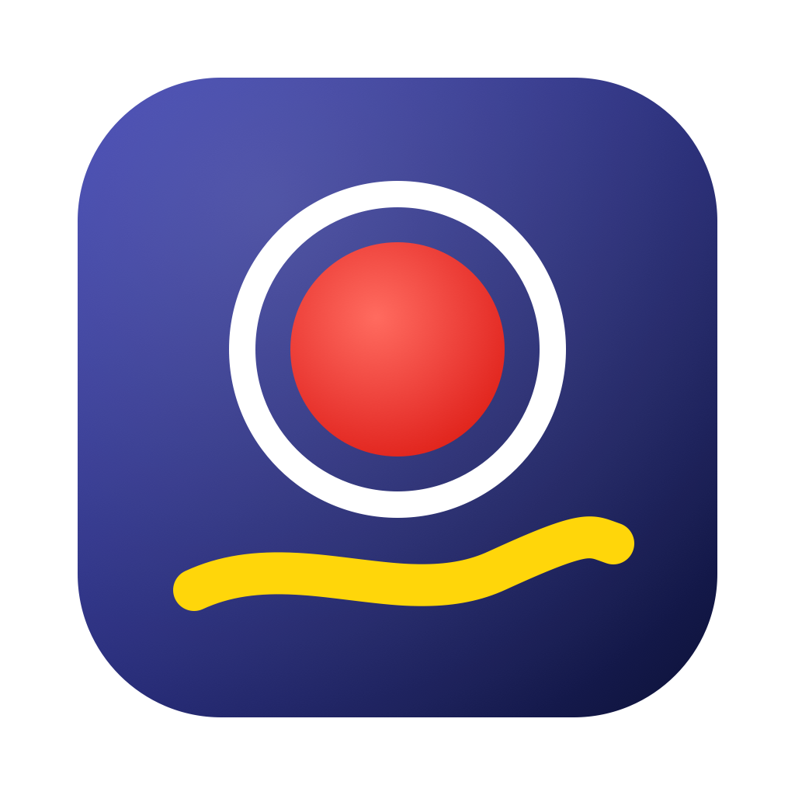

# TapeIt — Screen Recorder with Live Drawing for Mac



Record your screen, draw on it live, and share it to your own Google Drive. Free, native, no subscriptions.

- Full-screen or area recording (ScreenCaptureKit), saved to a folder and/or the clipboard
- Live annotation: pen, highlighter, arrows, rectangles, text, numbered steps, spotlight; fading or permanent ink
- Click ripples, keystroke display, webcam bubble, mic and system audio
- Editor: trim, MP4/GIF export, auto-zoom on clicks
- Dashboard: library with thumbnails, search, stats, upload queue
- Google Drive upload to your own account (`drive.file` scope only: TapeIt sees only files it uploads)

Built with Rust and Tauri 2, macOS 15+.

## Build

```sh
./make-signing-cert.sh   # once: stable local signing so permissions survive rebuilds
cd src-tauri
TAPEIT_GOOGLE_CLIENT_ID=... TAPEIT_GOOGLE_CLIENT_SECRET=... bunx @tauri-apps/cli@2 build --bundles app
```

Hotkeys (⌃⌥ +): R record, A area, D draw, C clear, F fade, S spotlight, W webcam, T toolbar.

[Privacy policy](https://tapeit.rajkasaudhan.com.np/privacy.html)
